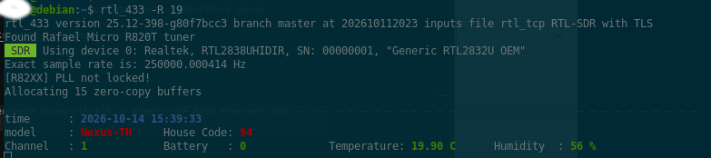
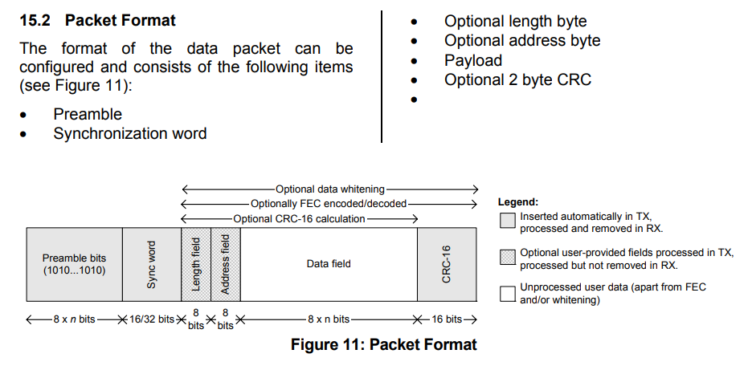

# Outside-Temperature

Quick program using a ESP32 S3 Mini and CC1101 (433MHz) transceiver to read the temperature from an outside Geevon temperature gauge.

This project has been inspired by a simular project by [lakrep](https://github.com/lakrep/the-receiver).

This project will be part of a bigger project for a touchscreen program in the future.

The code will be written using VSCode and the PlatformIO plug-in.

### Signal Investigation
Initial investigation of the radio in the outside temperature guage was via a DVD-T receiver using rtl_433, a generic RF data receiver and decoder for ISM band devices using RTL-SDR and SoapySDR. What it found was Nexus-TH signals and not Geevon ones!  Seems that the Geevon temperature monitor I have has an external unit usign the Nexus-TH protocol.

Nexus-TH protocol in rtl_433 decodes 36-bit OOK (On-Off Keying) Pulse Position Modulated (PPM) wireless sensors operating around 433.92 MHz

Modulation & Transmission
- Modulation: OOK pulse PPM
- Timing: ~500 µs pulse, ~1000 µs gap for binary 0, ~2000 µs gap for binary 1, and ~4000 µs sync gap.
- Repetition: Transmits 36 bits 12 times per burst (for Nexus-T/TH).

Decoded JSON Fields
- model: Nexus-T or Nexus-TH (also covers compatible brands like FreeTec, Solight, TFA Dostmann, infactory, and Bresser)
- id: Unique sensor ID / house code
- channel: Channel number (typically 1 to 3)
- battery_ok: Battery status flag (1 for ok, 0 for low)
- temperature_C: Temperature in Celsius
- humidity: Relative humidity (0–100%, optional for temperature-only models)
- test: Test button flag if pressed

Nexus-TH protocol in rtl_433 decodes 36-bit OOK (On-Off Keying) Pulse Position Modulated (PPM) wireless sensors operating around 433.92 MHz

Modulation & Transmission
- Modulation: OOK pulse PPM
- Timing: ~500 µs pulse, ~1000 µs gap for binary 0, ~2000 µs gap for binary 1, and ~4000 µs sync gap.
- Repetition: Transmits 36 bits 12 times per burst (for Nexus-T/TH).

Decoded JSON Fields
- model: Nexus-T or Nexus-TH (also covers compatible brands like FreeTec, Solight, TFA Dostmann, infactory, and Bresser)
- id: Unique sensor ID / house code
- channel: Channel number (typically 1 to 3)
- battery_ok: Battery status flag (1 for ok, 0 for low)
- temperature_C: Temperature in Celsius
- humidity: Relative humidity (0–100%, optional for temperature-only models)
- test: Test button flag if pressed

<figure>
  <figcaption>rtl_433 command line</figcaption>
  
</figure>

### Frequency tuning - in progress

The CC1101 modules can be a little off with the frequency.  This affects the quality of the received packets and can dramatically decrease the range at which you can receive packets from the Geevon.

You can buy a better Xtal like an Epson X1E0000210666 from Farnell (2471832), or change the frequency in initialisation. For my module I needed to set the frequency to 433.92MHz, I wasn't prepared to do any SMD soldering!

Below are some suggested values.  The default is/should be 433920000 Hz.

#### Ignore for now, work in progress #####
|    Freq   | Dec     | HEX    |
|:---------:|---------|--------|
| 868425000 | 2188965 | 2166A5 |
| 868400000 | 2188902 | 216666 |
| 868375000 | 2188839 | 216627 |
| 868350000 | 2188776 | 2165E8 |
| 868325000 | 2188713 | 2165A9 |
| *868300000* | *2188650* | *21656A* |
| 868275000 | 2188587 | 21652B |
| 868250000 | 2188524 | 2164EC |
| 868225000 | 2188461 | 2164AD |
| 868200000 | 2188398 | 21646E |
| 868175000 | 2188335 | 21642F |


To make these changes you will need to change these lines:
```
radio.writeRegister(CC1101_FREQ2, 0x21);
radio.writeRegister(CC1101_FREQ1, 0x65);
radio.writeRegister(CC1101_FREQ0, 0x6a);
```

Look at the LQI value in the debug output for an indication of received packet quality, lower is better.  

### CC1101 Packet Format



### Development Tasks

- Recieve packets and extract temperature information
- Convert to freeRTOS
- Feed data to existing MQTT queue on the Raspberry Pi
- Add a display
- Use Barr Group [C coding standards](https://barrgroup.com/sites/default/files/barr_c_coding_standard_2018.pdf)

### Notes
